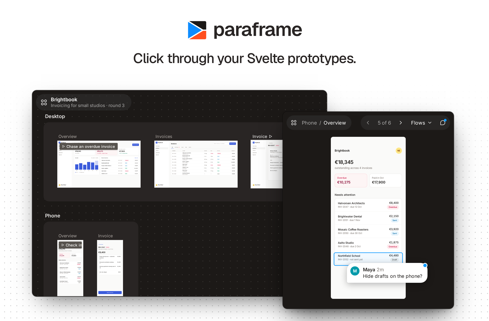
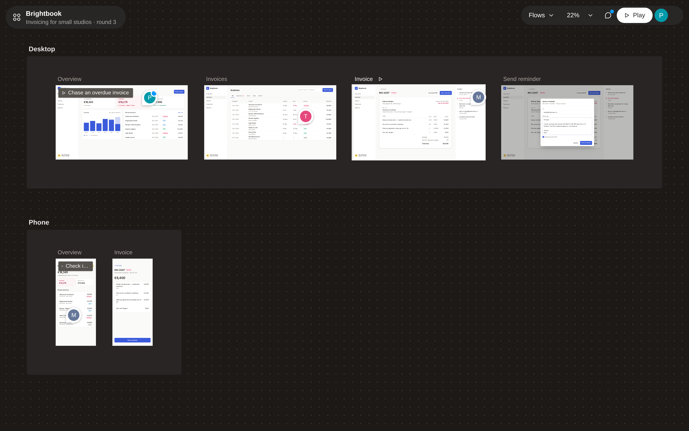
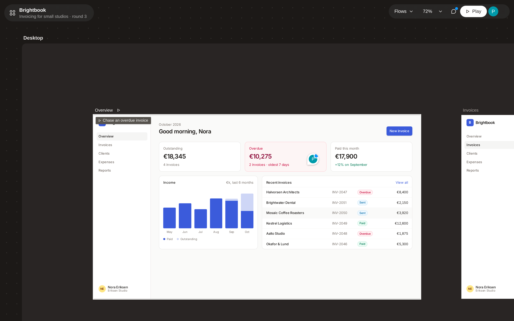
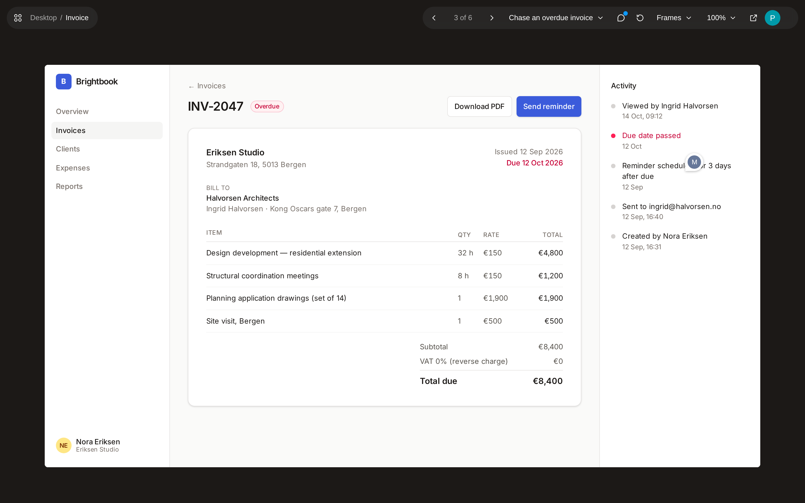
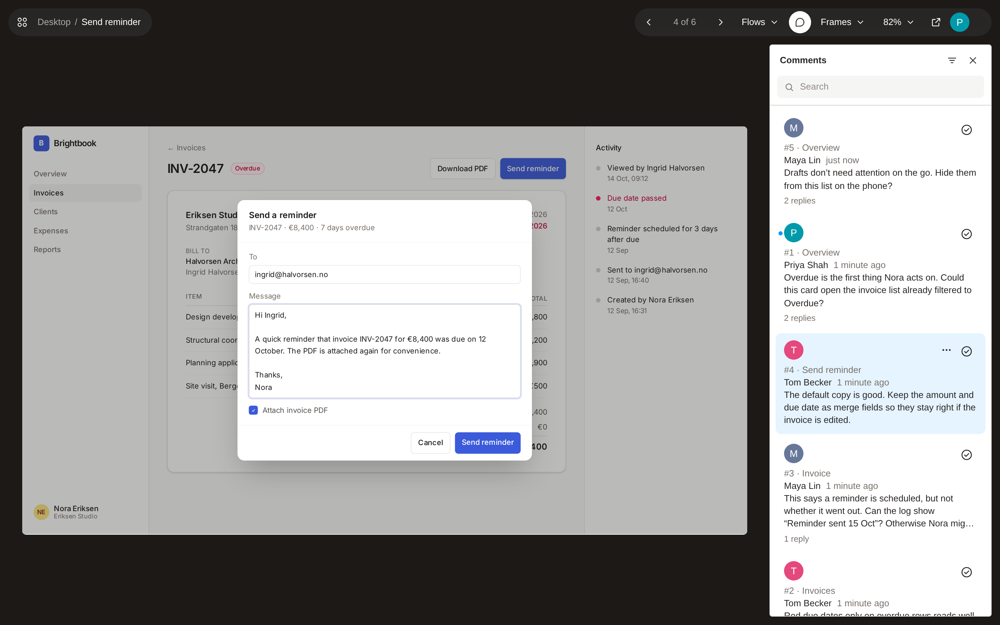
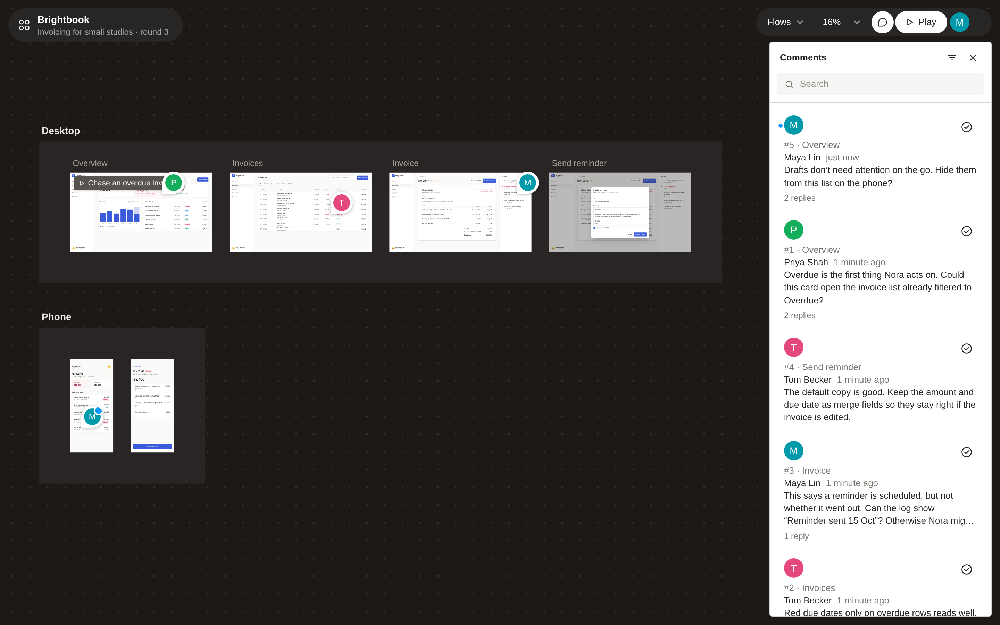

<p align="center">
  <a href="docs/SETUP.md">Setup</a> ·
  <a href="docs/COMMENTS.md">Comments</a> ·
  <a href="docs/DEVELOPMENT.md">Development</a>
</p>

paraframe is a read-only viewer for UI frames, in the style of a design tool's
prototype preview. You write each frame as a Svelte component, and paraframe
lays them out on a canvas and plays them one at a time. Frames are real
components, so anything inside them stays interactive.

- **Canvas.** Every frame in sections on a board you can pan and zoom.
- **Player.** One frame at a time, scaled to the window; named flows give you starting points.
- **Real components in iframes.** Each frame renders at its own size, with its own styles, media queries and fixed elements, isolated from paraframe's chrome.
- **Frame links.** Links, hotspots on any element, and navigation from code.
- **Static previews.** Optional images at overview scale that switch to live frames as you zoom in.
- **Comments.** Optional pinned threads on elements inside frames, through [visual-comments](../visual-comments).
- **Theming.** `--pf-*` custom properties for the chrome.

Requires SvelteKit 3, Svelte 5 and Tailwind 4 (the chrome is built with Tailwind).

## Quickstart

Add `paraframe` to your SvelteKit app, then define the prototype once:

```ts
// src/lib/prototype.ts
import { resolve } from '$app/paths';
import { definePrototype } from 'paraframe';

export const prototype = definePrototype({
	title: 'My product',
	size: { width: 1440, height: 900 }, // default frame size
	sections: [
		{
			id: 'onboarding',
			title: 'Onboarding',
			frames: [{ id: 'welcome', title: 'Welcome', load: () => import('./frames/Welcome.svelte') }]
		}
	],
	flows: [{ id: 'signup', title: 'Sign up', start: 'welcome' }],
	paths: {
		canvas: () => resolve(''),
		play: (frame) => resolve(`play/${frame}`),
		frame: (frame) => resolve(`frame/${frame}`)
	}
});
```

Then add three routes. The canvas and player share a layout that loads
paraframe's styles; the frame route loads your product's styles instead.

```
src/routes/
  +layout.ts                          export const prerender = true;
  (viewer)/+layout.svelte             import 'paraframe/styles.css'
  (viewer)/+page.svelte               <Canvas {prototype} />
  (viewer)/play/[frame]/+page.svelte  <Player {prototype} frameId={page.params.frame ?? ''} />
  frame/[frame]/+page.svelte          import your app's CSS; <FrameHost {prototype} resolved={data.resolved} />
```

The play and frame routes also need `+page.ts` files; [Setup](docs/SETUP.md)
has the full routes, frame sizes and props, static previews and theming.

To see a complete working prototype, clone this repository and run
`pnpm install && pnpm showcase`.

## Linking frames

Inside a frame:

```svelte
<script lang="ts">
	import { FrameLink, useFrameNav } from 'paraframe';
	const nav = useFrameNav();
</script>

<FrameLink to="details">Open details</FrameLink>

<!-- Any element, e.g. a table row -->
<tr {@attach nav.hotspot('details')}>…</tr>

<!-- From code -->
<button onclick={() => nav.go('details')}>Save</button>
```

Clicking where there is no link briefly highlights everything that is one.
Buttons, inputs and links never trigger this. If another element handles
clicks inside the frame (a selectable table row, say), add `data-pf-interactive` to it.

## Keys

| View | Keys |
| --- | --- |
| Player | ← → previous and next frame, R restart the flow (while one is playing), C comment mode, Esc close the open comment, then leave comment mode |
| Canvas | Scroll or drag to pan, ⌘/Ctrl + scroll to zoom, ⇧1 fit all, ⇧0 100%, F or ⇧2 center and fit the selection, ← → select previous and next frame, Enter play, C comment mode, Esc close the open comment, then leave comment mode |

On the canvas, hover live frames to inspect tooltips and hover states, and
double-click a frame to play it.

## Screenshots



<table>
  <tr>
    <td width="50%"><br />Zoom in and frames are live: hover states and tooltips work.</td>
    <td width="50%"><br />The player, partway through a flow.</td>
  </tr>
  <tr>
    <td><br />Comments pinned to elements, with the thread list beside the frame.</td>
    <td><br />Every thread across the prototype, from the canvas.</td>
  </tr>
</table>

The screenshots show an example invoicing prototype; `pnpm showcase` runs a
smaller one.

## Comments

Optional. Comments come from a [visual-comments](../visual-comments) server
through your prototype's own server, which also signs viewers in. Wrap the
viewer layout in `<Comments>` and viewers can press **C** to pin threads on
elements inside frames. See [Comments](docs/COMMENTS.md).

## License

[MIT](LICENSE)
